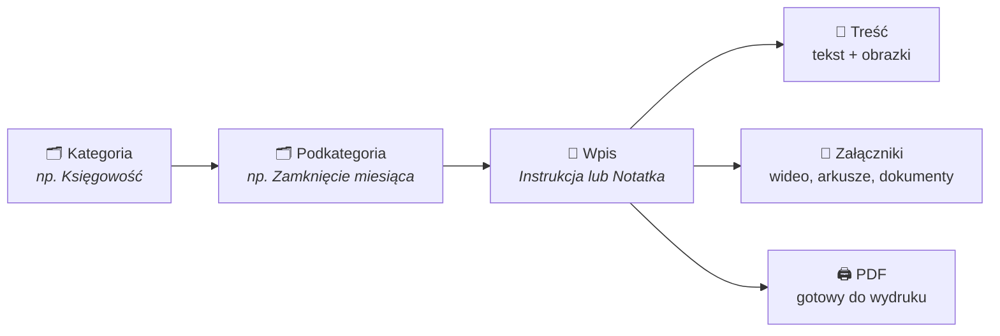
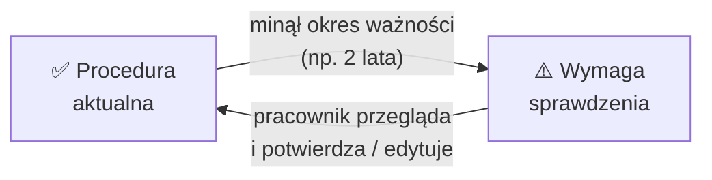
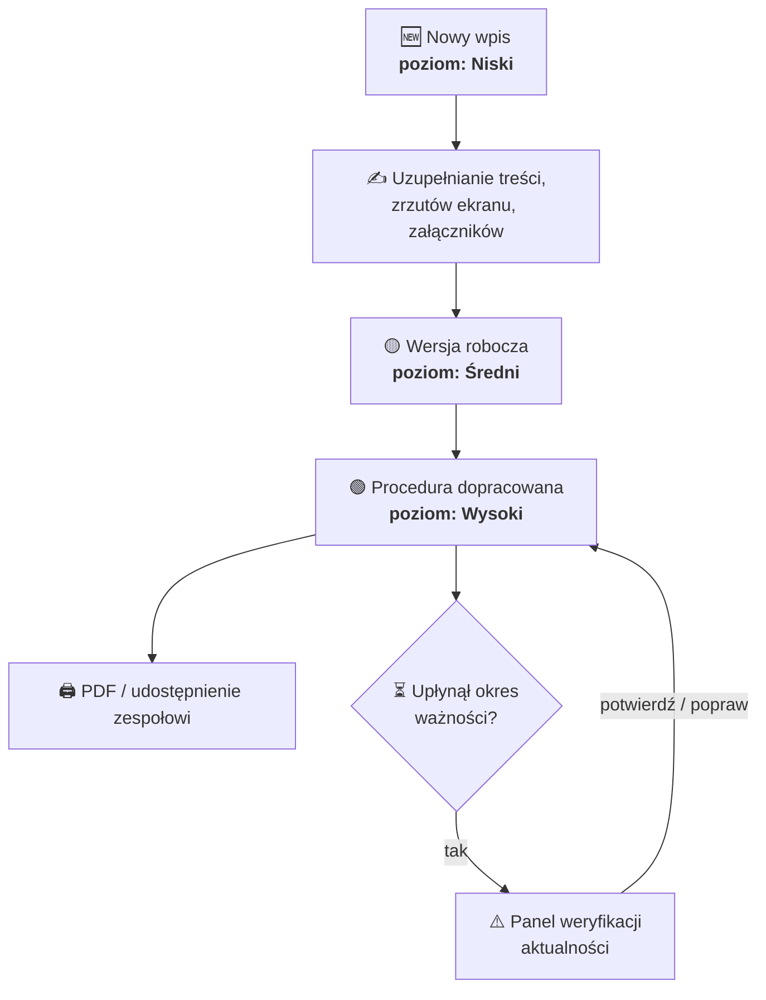

# 📘 Knowledge Forge — DOCUMENTATIONS

### Firmowy notatnik procedur, który pilnuje, żeby wiedza nie znikała i się nie starzała

*Instrukcje, procedury i notatki zespołu: w jednym miejscu, zawsze aktualne, zawsze do odzyskania.*

 

---

## 💡 O projekcie

W każdej firmie jest wiedza, która „siedzi w głowach”: jak przeprowadzić zamknięcie miesiąca, jak wdrożyć nowego pracownika, co zrobić, gdy padnie serwer. Kiedy ktoś odchodzi albo jest na urlopie, ta wiedza znika razem z nim.

**Knowledge Forge** to **notatnik do procedur firmowych**. Zamienia rozproszone pliki, maile i karteczki w **uporządkowaną, przeszukiwalną bazę instrukcji**. Każda procedura ma swoje miejsce w strukturze, swój poziom dopracowania, swoje załączniki, a system **sam przypomina**, kiedy trzeba ją sprawdzić ponownie.

> 🎯 **To projekt rekrutacyjny.** Pokazuje, jak od strony logicznej i funkcjonalnej zaprojektować narzędzie, które rozwiązuje realny problem biznesowy: **utratę i dezaktualizację wiedzy organizacyjnej**.

 

<table>
<tr>
<td width="33%" align="center">

### 🗂️ Porządek
Drzewo kategorii o dowolnej głębokości: działy, procesy, podprocesy

</td>
<td width="33%" align="center">

### ⏳ Aktualność
Procedury, których dawno nikt nie sprawdził, same zgłaszają się do przeglądu

</td>
<td width="33%" align="center">

### 🛡️ Bezpieczeństwo
Cztery niezależne poziomy kopii zapasowych i panel ratunkowy

</td>
</tr>
</table>

---

## 🧭 Jak zorganizowana jest wiedza

Każdy wpis ma **typ**:

| Typ | Do czego służy |
|:---:|---|
| 📋 **Instrukcja** | Formalna procedura krok po kroku, np. „Jak wystawić fakturę korygującą” |
| 🗒️ **Notatka** | Wiedza robocza, obserwacje, kontekst, np. „Uwagi z wdrożenia systemu X” |

i **poziom szczegółowości**, czyli to, jak bardzo wpis jest dopracowany (a nie jak trudny jest temat):

| Poziom | Znaczenie |
|:---:|---|
| 🔴 **Niski** | Szkic: temat zanotowany i zaplanowany do uzupełnienia |
| 🟡 **Średni** | Wersja robocza, spisana szybko, czytelna głównie dla autora |
| 🟢 **Wysoki** | Wersja dopracowana, zrozumiała dla każdego pracownika |

Dzięki temu od razu widać, które procedury są gotowe do przekazania nowej osobie, a które trzeba jeszcze dopisać.

---

## ✨ Funkcjonalności

### ✍️ Wygodne pisanie procedur
- **Edytor WYSIWYG**: nagłówki, listy, pogrubienia, tabele, bez znajomości żadnej składni.
- **Wklejanie zrzutów ekranu prosto ze schowka.** Instrukcja „kliknij tutaj” od razu ma obrazek.
- **Automatyczny PDF** każdej procedury, gotowy do wydruku albo wysłania.
- **Zbiorczy eksport PDF**: zaznaczasz kilka procedur i dostajesz jeden dokument (z paskiem postępu, możliwością anulowania i raportem problemów).

### 📎 Załączniki
- Do procedury można dołączyć **nagranie wideo, arkusz, dokument, archiwum lub obraz**, czyli wszystko, co pomaga ją wykonać.
- Wideo da się odtwarzać i przewijać bezpośrednio w aplikacji.

### 🔎 Szybkie odnajdywanie wiedzy
- **Wyszukiwanie pełnotekstowe** po tytule, opisie **i treści** procedur.
- **Panel filtrów**: autor, poziom szczegółowości, kategoria i podkategoria.

### ⏳ Weryfikacja aktualności, czyli serce systemu
Procedura sprzed dwóch lat może opisywać system, którego już nie ma. Knowledge Forge **liczy czas od ostatniego świadomego potwierdzenia** każdej procedury:

- Okres ważności i harmonogram kontroli są **konfigurowalne**, np. „co piątek o 17:00 sprawdź, co się przeterminowało”.
- Przeterminowane wpisy trafiają do osobnego **panelu „Weryfikacja aktualności”**, gdzie jednym kliknięciem można je potwierdzić.
- Edycja treści sama w sobie odnawia aktualność procedury.

### 🔄 Praca zespołowa na żywo
- Zmiany innych osób **pojawiają się natychmiast** we wszystkich otwartych przeglądarkach (WebSocket): nowa kategoria, zapisana procedura, dodany załącznik.
- Bez odświeżania strony i bez nadpisywania sobie nawzajem pracy.

### 🛡️ Wiedza, której nie da się stracić
Cztery **niezależne** poziomy ochrony danych. Każdy chroni przed inną awarią:

| # | Poziom | Chroni przed |
|:---:|---|---|
| 1️⃣ | **Automatyczna kopia bazy danych** z retencją | awarią lub uszkodzeniem bazy |
| 2️⃣ | **Każda procedura jako osobny plik** na dysku | utratą pojedynczego wpisu |
| 3️⃣ | **Codzienna zbiorcza paczka** wszystkich procedur | utratą wielu wpisów naraz, nawet przy pustej bazie |
| 4️⃣ | **Panel ratunkowy** w przeglądarce | sytuacji, w której *cała aplikacja* nie działa |

> 🚑 **Panel ratunkowy** pozwala otworzyć i przeczytać procedury z plików kopii zapasowej **bez działającego serwera i bazy**. Gdy wszystko leży, a trzeba właśnie przeczytać procedurę awaryjną, ona i tak jest dostępna.

### 🖥️ Komfort pracy
- Układ z **regulowaną szerokością paneli**: drzewo kategorii, lista wpisów i treść obok siebie.
- **Pamięć podręczna** ostatnio otwieranych procedur, więc przełączanie się między nimi jest natychmiastowe.
- Działa **od razu, bez logowania**: idealne na wewnętrzną sieć firmy lub stanowisko zespołu.

---

## 🔁 Cykl życia procedury

---

## 🎯 Dla kogo?

<table>
<tr>
<td>👩‍💼 <b>Działy administracji i księgowości</b></td>
<td>powtarzalne procedury miesięczne i roczne</td>
</tr>
<tr>
<td>🧑‍💻 <b>Zespoły IT i wsparcia</b></td>
<td>runbooki, procedury awaryjne, konfiguracje</td>
</tr>
<tr>
<td>🧑‍🏫 <b>HR i onboarding</b></td>
<td>instrukcje dla nowych pracowników</td>
</tr>
<tr>
<td>🏭 <b>Produkcja i logistyka</b></td>
<td>instrukcje stanowiskowe z nagraniami wideo</td>
</tr>
</table>

---

## 📚 Dokumentacja szczegółowa

Katalog [`dokumentacja/`](dokumentacja) opisuje poszczególne mechanizmy w szczegółach:

| Dokument | Temat |
|---|---|
| [`ACTUALITY_VERIFICATION.txt`](dokumentacja/ACTUALITY_VERIFICATION.txt) | Weryfikacja aktualności procedur |
| [`BACKUP_STRATEGY.txt`](dokumentacja/BACKUP_STRATEGY.txt) | Strategia ochrony danych, wszystkie poziomy |
| [`BACKUP_AND_RESTORE.txt`](dokumentacja/BACKUP_AND_RESTORE.txt) | Kopia i odtwarzanie bazy danych |
| [`formatDanych.txt`](dokumentacja/formatDanych.txt) | Co, gdzie i w jakiej postaci jest zapisywane |
| [`MULTITHREADING.txt`](dokumentacja/MULTITHREADING.txt) | Praca wielu użytkowników jednocześnie |
| [`NOTE_CACHE.txt`](dokumentacja/NOTE_CACHE.txt) | Pamięć podręczna treści procedur |

---

**Knowledge Forge**: bo procedura, której nikt nie może znaleźć, nie istnieje.

Projekt rekrutacyjny · autor: Przemysław Włodarczyk

