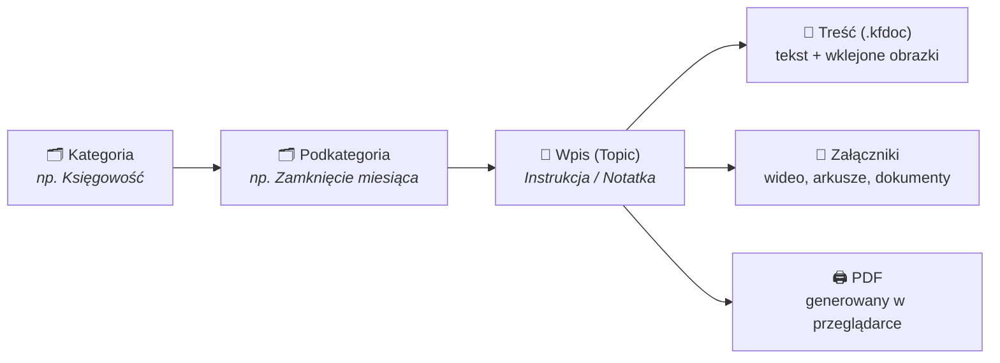
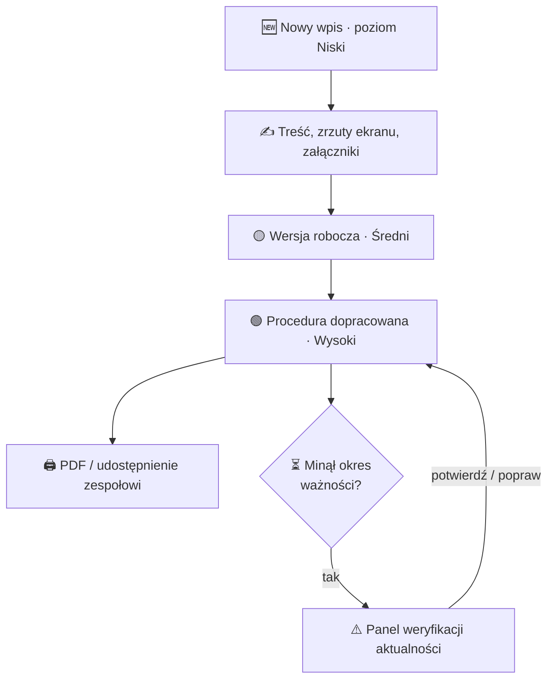
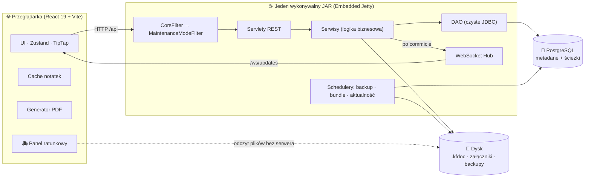
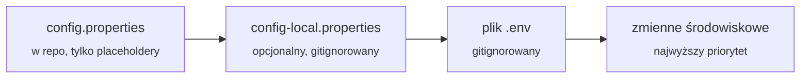
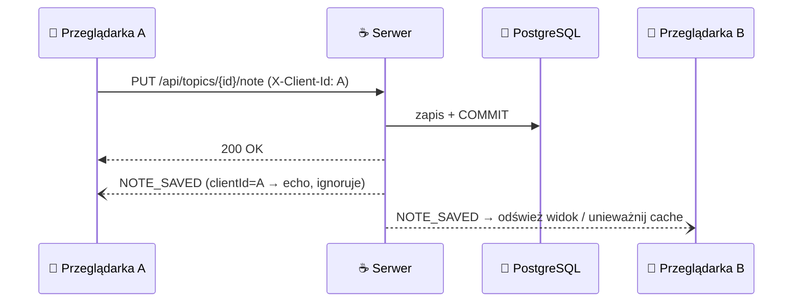
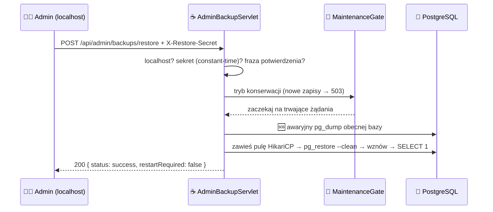

<div align="center">

# 📘 Knowledge Forge · DOCUMENTATIONS

### Firmowy notatnik procedur, który pilnuje, żeby wiedza nie znikała i się nie starzała

*Instrukcje, procedury i notatki zespołu: w jednym miejscu, zawsze aktualne, zawsze do odzyskania.*

<br/>


<br/>


<br/>

[💡 O projekcie](#-o-projekcie) ·
[✨ Funkcje](#-funkcjonalności) ·
[🏗️ Architektura](#️-architektura) ·
[🚀 Uruchomienie](#-uruchomienie) ·
[⚙️ Konfiguracja](#️-konfiguracja-i-sekrety) ·
[🔌 REST API](#-rest-api) ·
[📡 WebSocket](#-websocket--zmiany-na-żywo) ·
[🛡️ Backupy](#️-mechanizm-backupów) ·
[🔐 Bezpieczeństwo](#-bezpieczeństwo)

</div>

---

## 💡 O projekcie

W każdej firmie jest wiedza, która „siedzi w głowach”: jak przeprowadzić zamknięcie miesiąca, jak wdrożyć nowego pracownika, co zrobić, gdy padnie serwer. Kiedy ktoś odchodzi albo jest na urlopie, ta wiedza znika razem z nim.

**Knowledge Forge** to **notatnik do procedur firmowych**. Zamienia rozproszone pliki, maile i karteczki w **uporządkowaną, przeszukiwalną bazę instrukcji**. Każda procedura ma swoje miejsce w strukturze, swój poziom dopracowania i swoje załączniki, a system **sam przypomina**, kiedy trzeba ją sprawdzić ponownie.

> 🎯 **Projekt rekrutacyjny.** Pokazuje cały, świadomie zaprojektowany system: backend w **czystej Javie, bez frameworków** (ręczne DI, JDBC, serwlety), nowoczesny frontend w React, synchronizację na żywo przez WebSocket, przemyślaną wielowątkowość i **czteropoziomową strategię ochrony danych**.

<table>
<tr>
<td width="25%" align="center">

### 🗂️
**Porządek**<br/><sub>drzewo kategorii o dowolnej głębokości</sub>

</td>
<td width="25%" align="center">

### ⏳
**Aktualność**<br/><sub>przeterminowane procedury same zgłaszają się do przeglądu</sub>

</td>
<td width="25%" align="center">

### 🔄
**Na żywo**<br/><sub>zmiany zespołu widać natychmiast, bez odświeżania</sub>

</td>
<td width="25%" align="center">

### 🛡️
**Odporność**<br/><sub>4 niezależne poziomy backupu i panel ratunkowy</sub>

</td>
</tr>
</table>

---

## 🧭 Model wiedzy



| Typ wpisu | Do czego służy |
|:---:|---|
| 📋 **Instrukcja** | Formalna procedura krok po kroku, np. „Jak wystawić fakturę korygującą” |
| 🗒️ **Notatka** | Wiedza robocza i kontekst, np. „Uwagi z wdrożenia systemu X” |

| Poziom szczegółowości | Znaczenie (stopień dopracowania, nie trudność) |
|:---:|---|
| 🔴 **Niski** (`LOW`) | Szkic: temat zanotowany i zaplanowany do uzupełnienia |
| 🟡 **Średni** (`MEDIUM`) | Wersja robocza, czytelna głównie dla autora |
| 🟢 **Wysoki** (`HIGH`) | Wersja dopracowana, zrozumiała dla każdego pracownika |

---

## ✨ Funkcjonalności

<table>
<tr><td>

**✍️ Pisanie procedur**
- Edytor WYSIWYG (TipTap): nagłówki, listy, tabele
- **Wklejanie zrzutów ekranu ze schowka**
- PDF każdej procedury, generowany po stronie klienta
- **Zbiorczy PDF** z wielu procedur, z paskiem postępu, anulowaniem i raportem problemów

</td><td>

**📎 Załączniki**
- Wideo, arkusze, dokumenty, archiwa, obrazy
- Do 100 MB na plik (konfigurowalne), zapis strumieniowy z sumą SHA-256 liczoną w locie
- **Odtwarzanie i przewijanie wideo** w aplikacji (HTTP `Range`)

</td></tr>
<tr><td>

**🔎 Odnajdywanie wiedzy**
- Wyszukiwanie pełnotekstowe po tytule, opisie i **treści**
- Filtry: autor, poziom szczegółowości, kategoria

</td><td>

**⏳ Weryfikacja aktualności**
- Konfigurowalny okres ważności (np. `P2Y`) i harmonogram cron
- Panel „Weryfikacja aktualności”, gdzie potwierdzasz procedury jednym kliknięciem
- Edycja treści sama odnawia aktualność

</td></tr>
<tr><td>

**🔄 Praca zespołowa**
- Zdarzenia WebSocket dla każdej zmiany
- **Optymistyczne blokowanie** (`expectedVersion` / `baseVersion` → `409`), więc nikt nikomu nie nadpisze pracy

</td><td>

**🖥️ Komfort**
- Panele z regulowaną szerokością
- Cache notatek w pamięci karty (LRU 50, TTL 30 min)
- Działa od razu, **bez logowania** (jeden domyślny użytkownik)

</td></tr>
</table>

### Cykl życia procedury



---

## 🏗️ Architektura



**Zasada nadrzędna:** baza trzyma **wyłącznie metadane i ścieżki**, a ciężkie dane (treść notatek, bajty załączników) leżą jako zwykłe pliki na dysku.

| Warstwa | Technologie |
|---|---|
| **Backend** | Java 17 · `jakarta.servlet` · Embedded Jetty · **bez Springa i Hibernate** |
| **Dane** | PostgreSQL · JDBC + ręczne DAO · HikariCP · migracje w `config.Schema` (idempotentne DDL) |
| **JSON / cron** | Jackson · cron-utils |
| **Frontend** | React 19 · Vite 7 · React Router 7 · Zustand · Axios |
| **Edytor / PDF** | TipTap (rdzeń MIT) · jsPDF + html2canvas (ładowane leniwie) |
| **Build** | Maven + `maven-shade-plugin` → **jeden JAR = API + frontend, jeden port** |
| **Testy** | JUnit 5 (113 testów backendu, m.in. testy współbieżności) · Vitest + Testing Library |

<details>
<summary><b>📁 Struktura katalogów</b></summary>

```
src/main/java/com/example/knowledgeforge/
├── Main.java          # composition root: ręczne spięcie wszystkich obiektów + start Jetty
├── config/            # AppConfig (properties + env + .env), Database (HikariCP), Schema, DefaultUserSeeder
├── domain/            # POJO: encje, DTO, wyjątki (bez adnotacji)
├── dao/               # JDBC, jeden DAO na tabelę
├── service/           # logika biznesowa, ręczna walidacja, optymistyczne blokowanie
├── storage/           # NoteFileStorage (.kfdoc), AttachmentStorage (pliki)
├── document/          # DocumentContainer: format .kfdoc (ZIP)
├── backup/            # pg_dump / pg_restore, .kfbundle, MaintenanceGate, audyt
├── actuality/         # weryfikacja aktualności + scheduler
├── ws/                # WebSocket: hub zdarzeń, rejestr sesji, heartbeat
└── web/               # serwlety REST, CorsFilter, MaintenanceModeFilter, SpaServlet

frontend/src/
├── api/  ws/  cache/  # REST, WebSocket, cache notatek
├── components/        # drzewo kategorii, edytor, panele, modale
├── pages/  store/     # Dashboard, Zustand
└── utils/             # generator PDF, odczyt plików ratunkowych
```
</details>

---

## 🚀 Uruchomienie

### Wymagania

| Narzędzie | Wersja | Po co |
|---|---|---|
| ☕ JDK | **17** | backend (Maven Wrapper jest w repo: `./mvnw`) |
| 🟢 Node.js | 20+ | frontend |
| 🐘 PostgreSQL | 14+ | baza danych (najprościej przez Docker) |
| 🧰 `pg_dump` / `pg_restore` | zgodne z serwerem | automatyczne backupy bazy |

### 1️⃣ Sekrety: plik `.env`

```bash
cp .env.example .env
# uzupełnij DB_USERNAME, DB_PASSWORD (i ewentualnie DB_NAME / DB_URL)
```

> 🔒 Plik `.env` jest w `.gitignore` i **nigdy nie trafia do repozytorium**. Czyta go aplikacja, `docker compose` i testy.

### 2️⃣ Baza danych

```bash
docker compose up -d        # PostgreSQL z danymi dostępowymi z .env
```

### 3️⃣ Backend + frontend w jednym JAR-ze

```bash
cd frontend && npm install && npm run build && cd ..   # build trafia do src/main/resources/static
./mvnw clean package -DskipTests
java -jar target/knowledge-forge-documentations.jar
```

🌐 Aplikacja: **http://localhost:8081**. Tabele i migracje zakładają się same przy starcie.

### 🛠️ Tryb deweloperski (hot reload)

```bash
./mvnw clean package -DskipTests && java -jar target/knowledge-forge-documentations.jar   # API :8081
cd frontend && npm run dev                                                                 # UI  :3000 (proxy /api → :8081)
```

### 🧪 Testy

```bash
./mvnw test                 # backend: testy integracyjne używają bazy z .env (schemat kf_test)
cd frontend && npm test     # frontend: Vitest
```

### 🐳 Obraz Docker aplikacji

```bash
./mvnw clean package -DskipTests
docker build -t knowledge-forge-documentations .
docker run --env-file .env -p 8081:8081 knowledge-forge-documentations
```

<sub>W kontenerze `DB_URL` musi wskazywać host bazy osiągalny z kontenera (np. `host.docker.internal`). Do automatycznych backupów obraz potrzebuje `pg_dump` w wersji zgodnej z serwerem.</sub>

---

## ⚙️ Konfiguracja i sekrety

Konfiguracja jest ładowana warstwowo (**rosnący priorytet**):



- **W repozytorium nie ma haseł.** `config.properties` zawiera tylko odwołania do zmiennych:
  ```properties
  db.url=${DB_URL}
  db.username=${DB_USERNAME}
  db.password=${DB_PASSWORD}
  backup.restore.enabled=${BACKUP_RESTORE_ENABLED:false}
  backup.restore.secret=${BACKUP_RESTORE_SECRET:}
  ```
- Składnia `${NAZWA}` albo `${NAZWA:domyślna}`.
- **Każdy** klucz da się nadpisać zmienną według konwencji `backup.retention-days` → `BACKUP_RETENTION_DAYS`.
- Brak `DB_URL`, `DB_USERNAME` lub `DB_PASSWORD` **przerywa start** czytelnym komunikatem.

<details>
<summary><b>📋 Pełna lista ustawień</b></summary>

| Zmienna | Domyślnie | Opis |
|---|---|---|
| `DB_URL` · `DB_USERNAME` · `DB_PASSWORD` | **wymagane** | połączenie z PostgreSQL |
| `DB_NAME` · `DB_PORT` | — | używane przez `docker compose` |
| `SERVER_PORT` | `8081` | port HTTP |
| `CORS_ALLOWED_ORIGIN` | `http://localhost:3000` | origin dev-serwera frontendu |
| `NOTES_STORAGE_PATH` | `./data/notes` | pliki `.kfdoc` |
| `ATTACHMENTS_STORAGE_PATH` | `./data/attachments` | pliki załączników |
| `ATTACHMENTS_MAX_FILE_SIZE_MB` | `100` | limit pojedynczego pliku |
| `DEBUG_LOGGING` | `true` | szczegółowe logi (wyłącz na produkcji) |
| `BACKUP_ENABLED` | `true` | codzienny `pg_dump` |
| `BACKUP_DIRECTORY` | `./data/database-backups` | katalog zrzutów bazy |
| `BACKUP_RETENTION_DAYS` | `14` | retencja zrzutów |
| `BACKUP_SCHEDULE_HOUR` · `BACKUP_SCHEDULE_MINUTE` | `2` · `0` | godzina backupu (czas lokalny) |
| `BACKUP_PG_DUMP_PATH` · `BACKUP_PG_RESTORE_PATH` | `pg_dump` · `pg_restore` | ścieżki binarek |
| `BACKUP_RESTORE_ENABLED` | `false` | włącza endpoint administracyjny restore |
| `BACKUP_RESTORE_SECRET` | *(puste = zablokowane)* | sekret w nagłówku `X-Restore-Secret` |
| `NOTE_BUNDLE_BACKUP_ENABLED` | `true` | codzienna paczka `.kfbundle` |
| `NOTE_BUNDLE_BACKUP_DIRECTORY` | `./data/note-bundle-backups` | katalog paczki (inny niż notatek!) |
| `NOTE_BUNDLE_BACKUP_CRON` · `..._ZONE_ID` | `30 17 * * *` · `Europe/Warsaw` | harmonogram paczki |
| `ACTUALITY_VERIFICATION_ENABLED` | `true` | weryfikacja aktualności |
| `ACTUALITY_VERIFICATION_PERIOD` | `P2Y` | okres ważności (`java.time.Period`) |
| `ACTUALITY_VERIFICATION_CRON` · `..._ZONE_ID` | `0 17 * * 5` · `Europe/Warsaw` | kontrola co piątek o 17:00 |
| `UI_VISIBLE_BINARY_LOADER` | `false` | przycisk panelu ratunkowego w menu |
| `DEFAULT_USER_USERNAME` · `DEFAULT_USER_EMAIL` | `default` · … | domyślny użytkownik |

</details>

---

## 🔌 REST API

Bazowy adres: `http://localhost:8081`. Wszystkie odpowiedzi to JSON (poza plikami binarnymi).

> 💡 Nagłówek **`X-Client-Id`** (opcjonalny) identyfikuje kartę przeglądarki, dzięki czemu klient rozpoznaje w strumieniu WebSocket echo własnych zmian.

### 🗂️ Kategorie: `/api/categories`

| | Metoda | Ścieżka | Opis | Body |
|:-:|:-:|---|---|---|
| 🟢 | `GET` | `/api/categories/tree` | Całe drzewo kategorii | — |
| 🟢 | `GET` | `/api/categories/{id}/topics` | Wpisy w kategorii | — |
| 🔵 | `POST` | `/api/categories` | Nowa kategoria → `201` | `{ "name", "parentId?" }` |
| 🟠 | `PATCH` | `/api/categories/{id}` | Zmiana nazwy | `{ "name" }` |
| 🔴 | `DELETE` | `/api/categories/{id}` | Usunięcie kategorii | — |

### 📄 Wpisy (procedury): `/api/topics`

| | Metoda | Ścieżka | Opis |
|:-:|:-:|---|---|
| 🟢 | `GET` | `/api/topics?author=&detailLevel=&categoryId=` | Lista z filtrami |
| 🟢 | `GET` | `/api/topics/authors` | Lista autorów (do filtrów) |
| 🟢 | `GET` | `/api/topics/{id}` | Szczegóły wpisu |
| 🔵 | `POST` | `/api/topics` | Nowy wpis → `201` |
| 🟠 | `PATCH` | `/api/topics/{id}` | Edycja metadanych (z `expectedVersion`) |
| 🔴 | `DELETE` | `/api/topics/{id}` | Usunięcie wpisu |

<details>
<summary><b>Przykładowe body</b></summary>

```jsonc
// POST /api/topics
{
  "categoryId": "3f1c…",
  "title": "Zamknięcie miesiąca w systemie FK",
  "shortPrompt": "Kroki księgowania na koniec miesiąca",
  "author": "Anna",
  "detailLevel": "MEDIUM",     // LOW | MEDIUM | HIGH
  "type": "INSTRUCTION"        // INSTRUCTION | NOTE
}

// PATCH /api/topics/{id}: dowolny podzbiór pól + wersja do optymistycznego blokowania
{ "title": "Nowy tytuł", "detailLevel": "HIGH", "expectedVersion": 3 }
```
</details>

### 📝 Treść procedury: `/api/topics/{id}/note`

| | Metoda | Ścieżka | Opis |
|:-:|:-:|---|---|
| 🟢 | `GET` | `/api/topics/{id}/note` | Treść (JSON edytora, obrazki jako URL-e) |
| 🟡 | `PUT` | `/api/topics/{id}/note` | Zapis treści (upsert, z `baseVersion`) |
| 🟢 | `GET` | `/api/topics/{id}/note/assets/{plik}` | Pojedynczy wklejony obrazek |

```jsonc
// PUT /api/topics/{id}/note
{
  "contentJson": { "type": "doc", "content": [ … ] },   // drzewo TipTap / ProseMirror
  "assets": [ { "id": "img1.png", "mimeType": "image/png", "dataBase64": "iVBOR…" } ],
  "baseVersion": 7                                       // inna wersja na serwerze → 409 Conflict
}
```

### ⏳ Weryfikacja aktualności

| | Metoda | Ścieżka | Opis |
|:-:|:-:|---|---|
| 🟢 | `GET` | `/api/topics/actuality-review?author=` | Wpisy wymagające sprawdzenia |
| 🔵 | `POST` | `/api/topics/{id}/verify-actuality` | Potwierdź aktualność (`{ "expectedVersion" }`) |

### 📎 Załączniki

| | Metoda | Ścieżka | Opis |
|:-:|:-:|---|---|
| 🟢 | `GET` | `/api/topics/{id}/attachments` | Załączniki wpisu |
| 🔵 | `POST` | `/api/topics/{id}/attachments` | Upload `multipart/form-data`: `file` + opcjonalny `description` → `201` |
| 🟢 | `GET` | `/api/attachments/{id}` | Metadane załącznika |
| 🟢 | `GET` | `/api/attachments/{id}/view` | Podgląd / streaming (obsługa `Range` → `206`) |
| 🟢 | `GET` | `/api/attachments/{id}/download` | Pobranie pliku |
| 🔴 | `DELETE` | `/api/attachments/{id}` | Usunięcie |

### 🔎 Wyszukiwanie i konfiguracja UI

| | Metoda | Ścieżka | Opis |
|:-:|:-:|---|---|
| 🟢 | `GET` | `/api/search?q=fraza` | Pełny tekst: tytuł, opis, treść |
| 🟢 | `GET` | `/api/app-config` | Przełączniki UI, np. `{ "visibleBinaryLoader": false }` |

### 🔐 Administracja backupami: `/api/admin/backups`

> ⚠️ **Domyślnie wyłączone**: cała ścieżka zwraca `404`. Działa tylko z `127.0.0.1` / `::1` i z poprawnym nagłówkiem `X-Restore-Secret`.

| | Metoda | Ścieżka | Opis |
|:-:|:-:|---|---|
| 🟢 | `GET` | `/api/admin/backups` | Lista dostępnych zrzutów bazy |
| 🔵 | `POST` | `/api/admin/backups/restore` | Przywrócenie bazy z wybranego zrzutu |

### 🚦 Kody odpowiedzi

| Kod | Kiedy |
|:-:|---|
| `200` / `201` / `206` | sukces / utworzono / fragment pliku (`Range`) |
| `400` | błąd walidacji lub niepoprawne body |
| `401` / `403` | zły sekret / żądanie spoza localhost (endpoint admin) |
| `404` | zasób nie istnieje (albo wyłączony endpoint admin) |
| `409` | **konflikt wersji**: ktoś zapisał zmiany przed Tobą |
| `413` | załącznik przekracza limit rozmiaru |
| `503` | tryb konserwacji (trwa restore) lub wymagany restart |

---

## 📡 WebSocket: zmiany na żywo

**Endpoint:** `ws://localhost:8081/ws/updates` · heartbeat co 25 s

Serwisy publikują zdarzenia **wyłącznie po udanym commicie transakcji**. Zdarzenia niosą tylko identyfikatory i metadane, nigdy treść notatek ani plików.



| Grupa | Zdarzenia |
|---|---|
| 🗂️ Kategorie | `CATEGORY_CREATED` · `CATEGORY_UPDATED` · `CATEGORY_DELETED` |
| 📄 Wpisy | `TOPIC_CREATED` · `TOPIC_UPDATED` · `TOPIC_DELETED` |
| 📝 Treść | `NOTE_SAVED` |
| 📎 Załączniki | `ATTACHMENT_CREATED` · `ATTACHMENT_DELETED` |
| ⏳ Aktualność | `ACTUALITY_REVIEW_CHANGED` |

---

## 🛡️ Mechanizm backupów

Cztery **niezależne** poziomy. Każdy chroni przed inną klasą awarii i każdy z osobna wystarcza do odzyskania swojego zakresu danych.

```mermaid
flowchart TB
    subgraph L1["1️⃣ PostgreSQL · pg_dump"]
        direction LR
        a1["codziennie 02:00"] --> a2["knowledge-forge_YYYY-MM-DD_HH-mm-ss.dump"] --> a3["retencja 14 dni"]
    end
    subgraph L2["2️⃣ Pojedyncze pliki .kfdoc"]
        direction LR
        b1["każdy zapis notatki"] --> b2["atomowy zapis &lt;topicId&gt;.kfdoc"]
    end
    subgraph L3["3️⃣ Zbiorczy .kfbundle"]
        direction LR
        c1["codziennie 17:30"] --> c2["skan dysku, NIE bazy"] --> c3["walidacja → atomowa podmiana"]
    end
    subgraph L4["4️⃣ Panel ratunkowy 🚑"]
        direction LR
        d1["przeglądarka"] --> d2["czyta .kfdoc / .kfbundle<br/>bez serwera i bazy"]
    end
```



| # | Poziom | Co chroni | Kiedy | Przed czym |
|:-:|---|---|---|---|
| 1️⃣ | `pg_dump -Fc` | rekordy w bazie (kategorie, wpisy, metadane) | codziennie, retencja 14 dni | awaria lub uszkodzenie bazy |
| 2️⃣ | plik `.kfdoc` | treść jednej procedury z metadanymi | przy każdym zapisie | utrata rekordu, błędna ścieżka w bazie |
| 3️⃣ | `.kfbundle` | **wszystkie** `.kfdoc` naraz | codziennie, jeden nadpisywany plik | utrata wielu plików, nawet przy pustej bazie |
| 4️⃣ | panel ratunkowy | odczyt poziomów 2 i 3 | na żądanie | **cała aplikacja nie działa** |

### 1️⃣ Zrzut bazy PostgreSQL

- `pg_dump -Fc` zapisuje najpierw do `*.dump.part`. Dopiero po kodzie wyjścia `0` i niepustym pliku następuje **atomowe przeniesienie** na docelową nazwę.
- **Retencja** usuwa zrzuty starsze niż `BACKUP_RETENTION_DAYS`, ale **najnowszy nigdy nie jest usuwany**, a sprzątanie odpala się tylko po udanym nowym backupie.
- Harmonogram w czasie lokalnym, odporny na zmianę czasu letni/zimowy. Pomijany, gdy trwa inny backup lub restore.

### 2️⃣ Format `.kfdoc`: samodzielny plik procedury

Zwykły ZIP (otworzysz go 7-Zipem albo Eksploratorem Windows):

```
manifest.json    {"format":"kfdoc","version":1,"metadata":{ tytuł, autor, typ, kategoria, categoryPath, daty… }}
content.json     drzewo dokumentu TipTap / ProseMirror
assets/<plik>    wklejone obrazki, referencjonowane jako "asset:<plik>"
```

Zapis jest **atomowy**: unikalny plik `.tmp` w tym samym katalogu, potem `ATOMIC_MOVE`. Backup zbiorczy nigdy nie trafi więc na połowicznie zapisany plik.

### 3️⃣ Zbiorczy `.kfbundle`

```
knowledge-forge-notes-latest.kfbundle
├── manifest.json        {"format":"kfbundle","version":1,"documentCount":13,"corruptedCount":0,…}
├── index.json           tytuł, autor, kategoria, wersja, rozmiar, SHA-256 każdego dokumentu
└── documents/<topicId>.kfdoc …
```

1. Skanuje katalog notatek **bezpośrednio z dysku**. Klasa nie ma żadnej zależności od DAO, co potwierdza test refleksyjny.
2. Zapisuje do `.part`, zamyka i **ponownie otwiera, żeby zwalidować** (manifest, indeks, liczba dokumentów).
3. Dopiero potem atomowo podmienia poprzednią wersję. Przy błędzie stara paczka zostaje nietknięta.
4. Uszkodzony `.kfdoc` **nie przerywa** backupu: trafia do paczki z `corrupted: true`.

### 4️⃣ Panel ratunkowy 🚑

Gdy serwer lub baza leżą, a trzeba **natychmiast** przeczytać procedurę awaryjną, panel w przeglądarce wczytuje `.kfdoc` / `.kfbundle` lokalnie. Pliki rozpoznaje po zawartości, weryfikuje SHA-256 z indeksu i pokazuje treść procedur.

### ♻️ Przywracanie bazy



```bash
# .env: BACKUP_RESTORE_ENABLED=true, BACKUP_RESTORE_SECRET=$(openssl rand -hex 32)
curl http://127.0.0.1:8081/api/admin/backups -H "X-Restore-Secret: <SEKRET>"

curl -X POST http://127.0.0.1:8081/api/admin/backups/restore \
  -H "Content-Type: application/json" \
  -H "X-Restore-Secret: <SEKRET>" \
  -d '{ "backupFile": "knowledge-forge_2026-08-19_02-00-00.dump",
        "confirmation": "RESTORE KNOWLEDGE-FORGE" }'
```

| Wynik | Odpowiedź |
|---|---|
| ✅ Sukces, pula połączeń zdrowa | `200`, `restartRequired: false` |
| ⚠️ Sukces, ale pula nie wstała | `200`, `restartRequired: true`, wszystkie żądania dostają `503` aż do restartu |
| 🔁 Trwa inny backup lub restore | `409` |
| ❌ Awaryjny backup albo restore się nie udał | `500`, baza pozostaje nietknięta |

> ⚠️ **Załączniki** (`ATTACHMENTS_STORAGE_PATH`) **nie są objęte** żadnym z poziomów. Katalog trzeba zabezpieczyć osobno, np. kopią na inny wolumen.

---

## ⏳ Weryfikacja aktualności

Każdy wpis ma pola `actualityVerified` i `lastVerificationOfActualityDate`. Scheduler (cron, jawna strefa czasowa) oznacza jako *wymagające sprawdzenia* wpisy, których nikt nie potwierdził ani nie edytował od dłużej niż `ACTUALITY_VERIFICATION_PERIOD`. Mechanizm **nie ocenia treści**, liczy wyłącznie czas od ostatniego świadomego potwierdzenia. Błędny okres lub cron **przerywa start** aplikacji zamiast po cichu wyłączać funkcję.

---

## 🔐 Bezpieczeństwo

- 🔑 **Zero sekretów w repo**: `config.properties` ma tylko placeholdery `${…}`, a hasła są w `.env` lub zmiennych środowiskowych.
- 🚪 **Endpoint restore**: domyślnie `404`, tylko loopback (bez ufania `X-Forwarded-For`), sekret porównywany w stałym czasie, wymagana fraza potwierdzenia, pełny **dziennik audytu** każdej próby.
- 🧭 **Ścieżki plików**: nazwa backupu musi pasować do wzorca i po `normalize()` nie może wyjść poza katalog backupów.
- 🧹 Hasło do bazy jest przekazywane do `pg_dump` przez `PGPASSWORD` i **wycinane** z logowanego stderr.
- 🧵 Współdzielony stan wielowątkowy jest świadomie oznaczony w kodzie (`// MULTI-THREADING:`) i pokryty testami współbieżności.

---

## 📚 Dokumentacja szczegółowa

| Dokument | Temat |
|---|---|
| [`ACTUALITY_VERIFICATION.txt`](dokumentacja/ACTUALITY_VERIFICATION.txt) | Weryfikacja aktualności procedur |
| [`BACKUP_STRATEGY.txt`](dokumentacja/BACKUP_STRATEGY.txt) | Strategia ochrony danych, wszystkie poziomy |
| [`BACKUP_AND_RESTORE.txt`](dokumentacja/BACKUP_AND_RESTORE.txt) | Kopia i odtwarzanie bazy, procedury awaryjne |
| [`formatDanych.txt`](dokumentacja/formatDanych.txt) | Co, gdzie i w jakim formacie jest zapisywane |
| [`MULTITHREADING.txt`](dokumentacja/MULTITHREADING.txt) | Model wątków i synchronizacja |
| [`NOTE_CACHE.txt`](dokumentacja/NOTE_CACHE.txt) | Cache treści notatek we frontendzie |

---

<div align="center">

**Knowledge Forge**: bo procedura, której nikt nie może znaleźć, nie istnieje.

<sub>Projekt rekrutacyjny · Przemysław Włodarczyk</sub>

</div>
